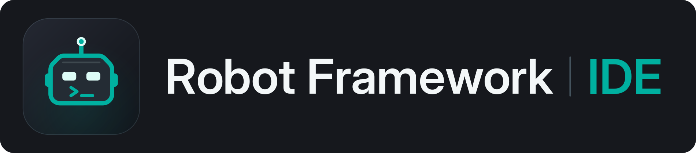
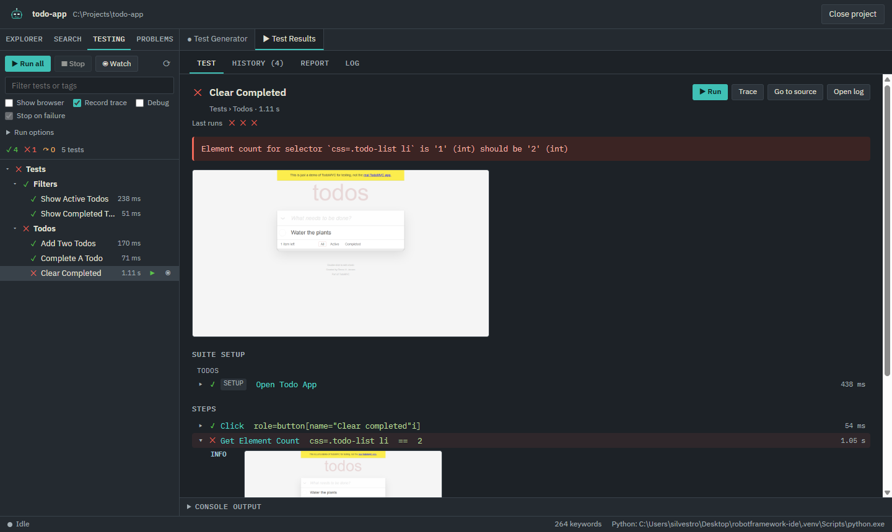
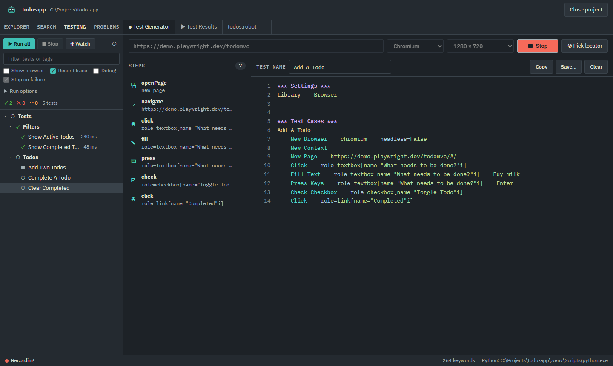
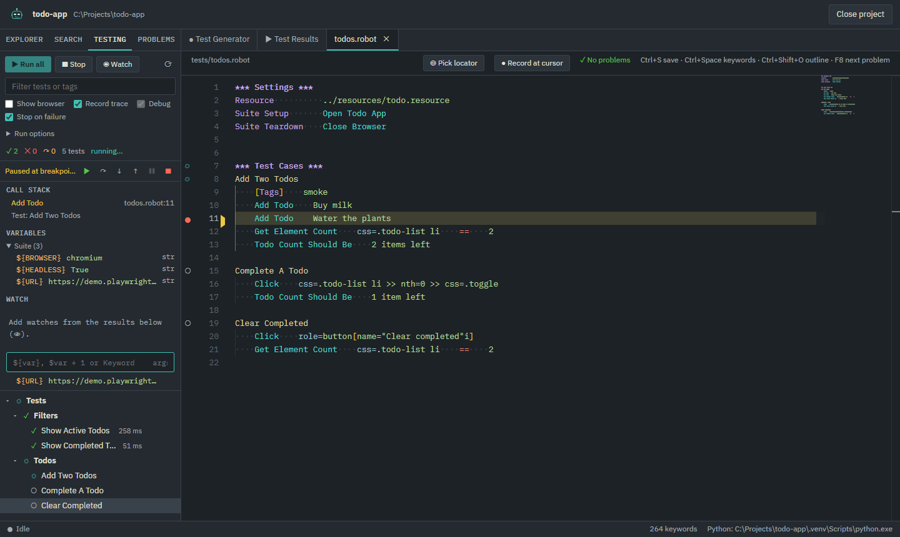
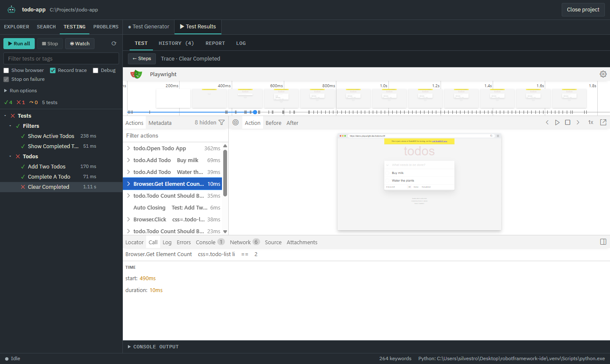
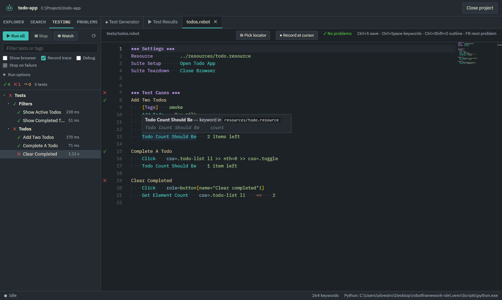

A desktop IDE for [Robot Framework](https://robotframework.org) tests written with the
[Browser library](https://robotframework-browser.org). It brings the tools Playwright users are used to
(codegen, UI mode, the trace viewer) to Robot Framework, next to an editor that understands `.robot` files.

- **Test Generator**: record clicks and typing in a real browser and get Browser library keywords back,
  with role-based selectors and assertions. You can also record straight into an open file, at the cursor.
- **UI mode**: run the whole project, a suite or one test, follow the steps as they run, re-run on save
  (watch mode) and compare a run with the previous ones.
- **Trace viewer**: every test gets a Playwright trace, opened inside the IDE with DOM snapshots, network and
  console, and Robot keywords as groups.
- **Debugger**: breakpoints (also conditional), stepping, call stack, variables, and evaluating keywords
  while paused, in the browser page the test left open.
- **Editor**: Monaco (the VS Code editor) with completion and docs for library keywords, go to definition,
  find references, rename, quick fixes, argument checks and Robocop formatting and linting.

It is built around the Browser library: the generator writes Browser keywords, and traces, failure
screenshots and the locator picker come from its Playwright backend. SeleniumLibrary is not supported.

## Install

Windows 10/11 only for now.

1. Download `RobotFrameworkIDE-Setup-<version>.exe` from the
   [latest release](https://github.com/silvestrodecaro/robot-ide/releases/latest).
2. Run it. It installs for the current user, without administrator rights. The installer is not signed, so
   SmartScreen will say *"Windows protected your PC"*: choose *More info*, then *Run anyway*.
3. Install [Python 3.10 or later](https://www.python.org/downloads/) (tick *Add python.exe to PATH*) and
   [Node.js LTS](https://nodejs.org), which the Browser library needs for `rfbrowser init`.
   Git is optional.

The IDE checks for new versions at start-up and asks before downloading one.

## Getting started

On the welcome screen choose **New project**. The IDE creates the folder with an example suite, a virtual
environment with Robot Framework, Browser and Robocop, and installs the browsers. Any existing folder with
`.robot` files can be opened too: each project uses its own `.venv` (or the Python set in `rfide.json`).

Then:

1. Open **Test Generator**, type a URL and press **Record**. Use the toolbar in the recorded page to add
   assertions. Save the result in `tests/`.
2. Switch to the **Testing** tab in the sidebar and press **Run all**, or ▶ next to a test in the editor.
3. Click a test to see its steps, the failure screenshot and the **Trace**.
4. To stop somewhere, click left of a line number to set a breakpoint and tick **Debug**.

The [user guide](docs/user-guide.md) covers every feature and shortcut.

## Status

The IDE is in early development (0.x) and is used daily on Browser library projects. Until 1.0, settings and
behavior may still change between versions. Bug reports and ideas are welcome in the
[issues](https://github.com/silvestrodecaro/robot-ide/issues).

To build it from source or run the tests, see [CONTRIBUTING.md](CONTRIBUTING.md).

## Code signing policy

Free code signing provided by [SignPath.io](https://about.signpath.io), certificate by
[SignPath Foundation](https://signpath.org).

Releases are built from this repository by GitHub Actions ([release.yml](.github/workflows/release.yml)) and
signed only after a manual approval.

- Committers and reviewers: [members of this repository](https://github.com/silvestrodecaro/robot-ide/graphs/contributors)
- Approvers: [Silvestro De Caro](https://github.com/silvestrodecaro)

## Privacy

The IDE does not collect or send any data about you or your projects. It connects to the internet only to:

- check GitHub Releases for a new version at start-up, and download it if you accept;
- download the Playwright browsers when you install them;
- open the pages you record, run or debug.

## License

[MIT](LICENSE)
