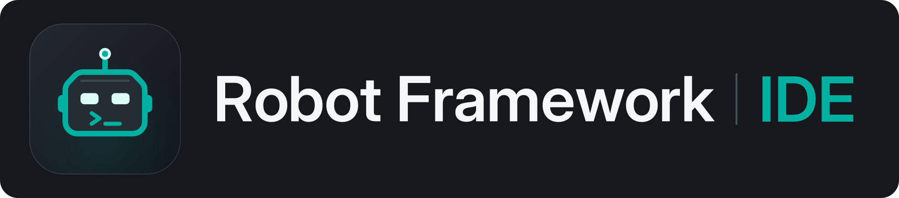
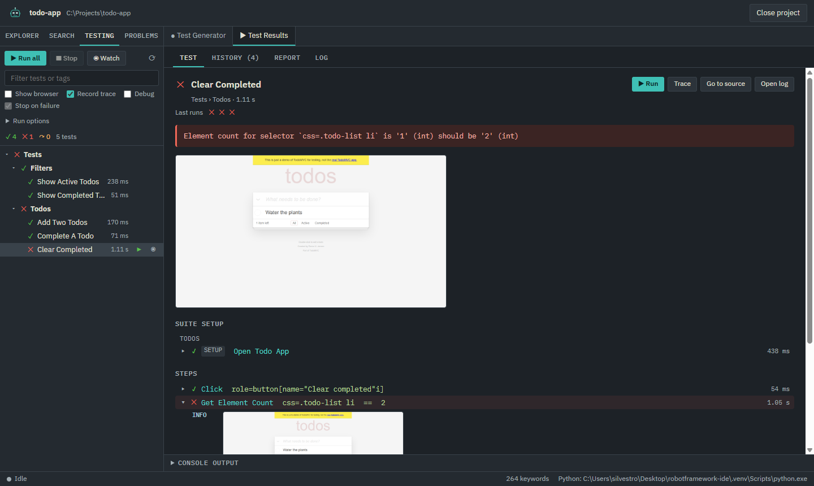

<p align="center"></p>

<p align="center"><a href="https://github.com/silvestrodecaro/keywright/actions/workflows/verify.yml"></a> <a href="LICENSE"></a></p>

Keywright is a desktop IDE for [Robot Framework](https://robotframework.org/) web tests
using [Browser library](https://robotframework-browser.org/). Record a browser interaction
as Robot keywords, edit the test, run it, and inspect the failed keyword, screenshot
or Playwright trace from the same project.

[Setup](#run-from-source) · [First run](#first-run) · [User guide](docs/user-guide.md) ·
[Troubleshooting](docs/troubleshooting.md) · [Development](CONTRIBUTING.md)



## Working with tests

| Task | What Keywright provides |
| --- | --- |
| Write a browser test | Test Generator records actions and assertions as Browser keywords. Pick a locator or record steps directly into an open file. |
| Maintain a suite | Monaco editor with keyword completion and documentation, navigation, references, rename, quick fixes, argument checks and Robocop integration. |
| Run a test or suite | Test selection, tag filters, Robot arguments, dry run, streamed keyword results and re-runs when watched files change. |
| Investigate a failure | Source navigation, Browser screenshots, Robot logs and reports, context traces, breakpoints, stepping and variable inspection. |
| Compare results | A local history of the last 30 run summaries, including newly failing, fixed and slower tests. |

Tests remain ordinary `.robot` and `.resource` files. They can be edited in another
editor and run with the project's Python outside Keywright. Recorded code is a
starting point: review selectors and assertions, and move repeated behavior into
user keywords as the suite grows.

## Scope and status

Keywright is in early development, currently version **0.1.0**. Run it from source
while the project is being tested and refined. Installer releases are on hold until
they can be code-signed.
Settings and behavior may change before 1.0.

- **Platform:** Windows 10/11. Development and integration tests currently target
  Windows; other desktop platforms have not been verified.
- **Browser integration:** Browser library. The recorder, locator picker,
  screenshots and trace integration target its Playwright backend.
- **SeleniumLibrary:** not a supported integration. Keywright does not generate
  SeleniumLibrary tests or translate existing SeleniumLibrary suites.
- **Projects:** a project-local `.venv` by default, or an explicit Python path in
  `keywright.json`. Existing layouts can configure the test and results directories.

How dependable each part is today:

| Area | Status |
| --- | --- |
| Opening projects, editing, running tests, results with screenshots, save conflicts and recovery of unsaved files | Exercised by desktop UI tests in CI on every push |
| Test Generator and locator picker | Built on Playwright's private recorder API. Playwright is pinned to a tested version because an update can change that API |
| Installer and automatic updates | Not available. They return once releases can be code-signed |
| macOS and Linux | Not tested |

See the guide for [configuration](docs/user-guide.md#project-configuration) and
[current limitations](docs/user-guide.md#current-limitations), including saved-file
execution and trace availability.

## Run from source

### Prerequisites

Use Windows 10/11. The setup checks these tools before installing app dependencies:

| Tool | Version to use | Check in PowerShell |
| --- | --- | --- |
| [Node.js](https://nodejs.org/en/download) with npm | 24.x or 26.x LTS | `node --version` and `npm.cmd --version` |
| [Python](https://www.python.org/downloads/windows/) | 3.13.x, available through the Windows `py` launcher | `py -3.13 --version` |
| [Git](https://git-scm.com/install/windows) | Optional for the app; used to clone and update the repository | `git --version` |

If Node.js or Python is missing or unsupported, setup offers to install a supported
version through WinGet and asks for confirmation with `y/n`. If WinGet is
unavailable, it shows the official download link. Exact tested package versions are listed in
[Contributing](CONTRIBUTING.md#verified-environment).

### Install and launch

Open PowerShell in the folder where you want to clone Keywright, then run:

```powershell
git clone https://github.com/silvestrodecaro/keywright.git
cd keywright
.\setup.bat
```

Without Git, use **Code → Download ZIP** on GitHub, extract the archive and open
`setup.bat` in the extracted folder. The setup works from another terminal folder
too: it finds its own repository directory.

Setup installs the locked app dependencies, Electron and Chromium, prepares the
included example's Python environment, builds the editor and runs its two browser
tests. It also reports dependency audit findings. The full output is saved under
`out/setup/`; a failed step stops setup and shows the error and log path.
See [Troubleshooting](docs/troubleshooting.md) for installation and launch errors.

When setup finishes, choose whether to open Keywright. To try the prepared example,
choose **Open folder…**, select `examples/browser-walkthrough` inside the clone,
then select **Testing → Run all**. Both tests should pass.

Browser executables are stored in the user cache, outside project virtual
environments. Projects can stay in their chosen folders, including nested paths
and paths containing spaces. Each Robot project still has its own Python environment.

For later launches, open PowerShell in the same `keywright` folder and run
`npm.cmd start`. Setup and start show progress and timings; launch logs are in
`out/start/`. Expand **Update Keywright** on the welcome screen for
[update instructions](docs/user-guide.md#updates-and-local-settings).
See [manual setup](CONTRIBUTING.md#development-setup) for the individual commands.

## First run

To create your own test project after trying the included example:

1. Choose **New project**, enter a name such as `my-web-tests` and select a writable
   parent folder.
2. Keep virtual environment and browser installation enabled, then choose
   **Create project**. The wizard creates `.venv`, installs the Python packages and
   downloads Browser's browsers. Wait for the setup steps to finish, then choose
   **Open project**. If a step fails, its output remains visible and the folder is
   kept: see [repair a partial setup](docs/troubleshooting.md#project-setup-stopped-partway-through).
3. Select **Testing → Run all**. The generated project contains one test, so the
   expected result is **one passing test**. It opens `https://example.com` and
   requires network access. The footer should show the Python executable inside
   this test project's `.venv`.

To try recording and failure analysis with a supplied local page, follow
[Record a test and investigate a failure](docs/walkthrough.md). That example has
two tests and works offline after its dependencies and browsers are installed.

Already have Robot tests? Choose **Open folder…** and select their project folder.
If they need an environment or use a different layout, follow
[open an existing project](docs/user-guide.md#open-an-existing-project). Opening a
folder reads its files; environment setup is a separate step.

## Documentation

| Document | Contents |
| --- | --- |
| [Walkthrough](docs/walkthrough.md) | Run the supplied example, record a test, reuse a resource and inspect a failure |
| [User guide](docs/user-guide.md) | Projects, editor, recording, execution, debugging, configuration and shortcuts |
| [Troubleshooting](docs/troubleshooting.md) | Environment setup, discovery, browser launch, missing traces and editor issues |
| [Contributing](CONTRIBUTING.md) | Development setup, tests, integration prerequisites and dependency review |
| [Architecture](docs/architecture.md) | Electron/Python boundaries, application flows, persistence and integration contracts |
| [Changelog](CHANGELOG.md) | Changes in each version |

## Local data and network access

Project files and Robot output are stored in the project directories. Run summaries
are kept in the configured results folder; recent projects, interface settings and
copies of unsaved files are stored in Electron's user-data directory. Keywright has
no analytics or telemetry integration in the application source.

Source runs do not check for application updates. Project setup downloads Python
packages and Browser dependencies; browser installation downloads browser binaries.
Recorded pages and executed tests make
the network requests their applications and test code require. Logs, screenshots
and traces may contain data from the system under test; review them before sharing.

## Contributing and support

Report a reproducible problem or propose a change in the
[issue tracker](https://github.com/silvestrodecaro/keywright/issues).
Include the Keywright version, project Python and relevant package versions, the
steps to reproduce, and a small example with sensitive data removed.
Report security vulnerabilities privately as described in [SECURITY.md](SECURITY.md).

Development instructions are in [CONTRIBUTING.md](CONTRIBUTING.md).
Keywright is available under the [MIT license](LICENSE).
