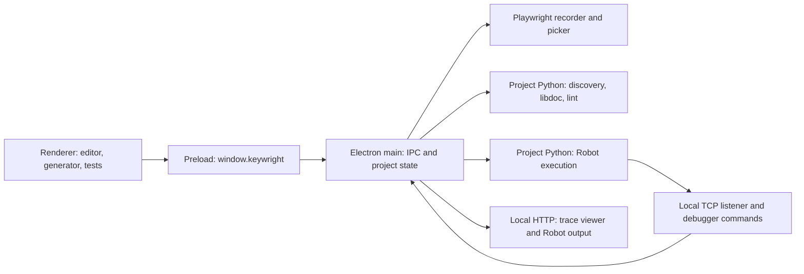

# Architecture

Keywright is an Electron desktop application with plain JavaScript UI modules,
a bundled Monaco integration, and Python helpers executed in each test project's
environment. This document describes the current implementation; read the linked
source before relying on a contract during a change.

## Process boundaries

The main window enables `contextIsolation` and sandboxing and disables Node
integration. [preload.js](../src/main/preload.js) exposes specific methods and event
subscriptions through `window.keywright`. [main.js](../src/main/main.js) registers IPC
handlers, owns the active project and services, and publishes state to the renderer.

The recorder's Playwright runs in the app's Node environment. Test execution and
library inspection use the selected project Python. These are distinct toolchains
and can require different browser binaries.

`browserEnvironment.js` selects Playwright's user cache unless
`PLAYWRIGHT_BROWSERS_PATH` is explicitly configured. `pythonHelper.js` applies this
environment to Robot processes, and project setup uses it for Browser initialization.
On Windows the default cache is `%LOCALAPPDATA%\ms-playwright`. Keeping browser
executables out of `.venv` makes their paths independent of the project directory depth.

## Source ownership

| Area | Source | Responsibility |
| --- | --- | --- |
| Application lifecycle | [main.js](../src/main/main.js), [preload.js](../src/main/preload.js) | Window, IPC, active project, services and shutdown |
| Project setup and files | [projects.js](../src/main/projects.js), [projectTemplate.js](../src/main/projectTemplate.js) | Tool detection, scaffold, environment setup, configuration, tree and file access |
| File changes | [projectWatcher.js](../src/main/projectWatcher.js) | Recursive watch, ignored paths and debounced change events |
| Recent projects | [recentProjects.js](../src/main/recentProjects.js) | Application-level recent-project list |
| Recording | [recorder.js](../src/main/recorder.js), [browserInstall.js](../src/main/browserInstall.js) | Recorder/picker sessions, action events and app-side browser installation |
| Source generation | [robotGenerator.js](../src/generator/robotGenerator.js), [selectors.js](../src/generator/selectors.js), [escape.js](../src/generator/escape.js) | Recorded actions to Robot keywords, Browser locators and escaped cells |
| Robot processes | [testRunner.js](../src/main/testRunner.js), [pythonHelper.js](../src/main/pythonHelper.js) | Discovery, process environment, run arguments, event transport and stop |
| Python implementation | [keywright_runner.py](../src/python/keywright_runner.py) | Discovery, selection modifier, listener, debugger, library docs, syntax and lint |
| Editor services | [keywordIndex.js](../src/main/keywordIndex.js), [languageWorker.js](../src/main/languageWorker.js), [formatter.js](../src/main/formatter.js), [projectVariables.js](../src/main/projectVariables.js) | Completion data, persistent diagnostics worker, formatting and static variable index |
| Search | [projectSearch.js](../src/main/projectSearch.js), [searchCore.js](../src/renderer/searchCore.js), [search.js](../src/renderer/search.js) | Disk traversal, matching/replacement and open-buffer coordination |
| Artifacts | [traceServer.js](../src/main/traceServer.js), [runHistory.js](../src/main/runHistory.js) | Local output serving and bounded run summaries |
| UI shell | [app.js](../src/renderer/app.js), [index.html](../src/renderer/index.html), [styles.css](../src/renderer/styles.css) | Welcome/setup, project tabs, file saves, shared structure and visual tokens |
| Workspace saves | [workspaceFiles.js](../src/renderer/workspaceFiles.js) | Per-file save queue, editor snapshots, disk revision conflicts and shared run preparation |
| Keyboard navigation | [treeNavigation.js](../src/renderer/treeNavigation.js) | Visible-tree navigation, focus restoration and tab-group keyboard behavior |
| Feature panels | [generator.js](../src/renderer/generator.js), [tests.js](../src/renderer/tests.js), [problems.js](../src/renderer/problems.js), [history.js](../src/renderer/history.js) | Feature state, rendering and interaction |
| Editor integration | [editor/index.js](../src/renderer/editor/index.js) | Monaco providers, models, commands, recording region, breakpoints and gutter results |
| Pure editor analysis | [robotSyntax.js](../src/renderer/editor/robotSyntax.js), [argumentCheck.js](../src/renderer/editor/argumentCheck.js), [navigation.js](../src/renderer/editor/navigation.js), [rename.js](../src/renderer/editor/rename.js), [quickFix.js](../src/renderer/editor/quickFix.js) | Syntax/cell analysis, argument checking, scopes, references and edit construction |
| Other shared logic | [tagPatterns.js](../src/renderer/tagPatterns.js), [watchPlan.js](../src/renderer/watchPlan.js), [runDiff.js](../src/renderer/runDiff.js), [highlight.js](../src/renderer/highlight.js) | Robot tag matching, conservative watch selection, history comparison and code display |

## Project and file lifecycle

`projects.loadProject()` merges optional `keywright.json` with template defaults. It
chooses an explicit configured interpreter or the project's `.venv`, checking that
the executable exists. Package availability is determined by subsequent operations,
not by that existence check.

Opening a project stops the current runner, language worker and recorder/picker
sessions, loads project state and recreates its file watcher. File changes are
published as project-relative paths. The renderer reloads unmodified open files and
refreshes indices, diagnostics, search and watch-mode selection as applicable.

Monaco owns open model contents, view state and saved-version identifiers. The UI
coordinates save IPC and tab prompts through `WorkspaceFiles`. Each save captures
the content and Monaco alternative-version ID together, queues behind prior saves
of that file, and marks only that captured version saved. The tab retains the
revision returned by the last read or successful write. Watcher reloads never
advance the revision of a dirty model or apply a response made stale by a newer edit.

`projects.readProjectFile()` returns a SHA-256 revision of the bytes read.
`writeProjectFile()` requires that revision, writes a temporary sibling, rechecks
the destination and renames the replacement. It returns either the new revision
or a conflict without overwriting. A deleted destination has revision `null` and
requires explicit recreation. This is optimistic conflict detection, not a
filesystem lock against arbitrary concurrent writers. Native dialogs offer cancel,
overwrite or reload; there is no automatic merge or comparison view.

`WorkspaceFiles.read()` turns file-opening failures into a non-editable tab with
a reason and recovery guidance. It removes the Electron IPC wrapper from errors;
an outside-project destination gets a specific instruction to open its folder.
Close and reopen the tab to retry after repairing the path or permissions.

`resolveInProject()` delegates to [pathBoundary.js](../src/main/pathBoundary.js).
It checks the requested path and its canonical destination against the project
root, resolving symbolic links and Windows junctions. New paths are checked through
their nearest existing ancestor; dangling links are refused. The selected project
root may itself be a link. Read, save, create and disk replacement use this check.
Saving resolves the requested path again before replacement so a retargeted link
cannot silently mark a different file saved. These are checks at the time of each
operation, not a filesystem sandbox or a lock against concurrent directory changes.

## Recording and generation

`RecorderSession` owns its Playwright browser, context, active page, recording state
and optional locator-picking operation. It starts the private context recorder in
`jsonl` mode. Action callbacks maintain the recorded action list, including page
identifiers and popup/download/dialog signals.

Stopping awaits Playwright's recording stop before closing the browser, retaining
final recorder events while excluding shutdown-generated page closures. Callbacks
are tied to their recording generation so late events cannot change a completed
recording or a later session.

The main process converts that list to full test source and step-only source.
The generator panel displays a standalone test; the editor's record-at-cursor mode
uses only the steps and supplies its own indentation and undo boundary.

The generator is pure JavaScript. Escaping and selector conversion are separate
from action translation. Multi-page recordings track page aliases; signals may add
dialog, download or page-switch keywords. File uploads and unsupported actions
include comments that require review.

Playwright's `_startRecording`, `_stopRecording`, `pickLocator` integration and
internal selector representation are upgrade-sensitive. `playwright-core` is pinned
to an exact version. Verify real recording and Browser replay after changing it;
unit coverage of generated strings does not exercise the recorder contract.

## Robot execution and debugging

`TestRunner` builds Robot arguments from project paths, test selection, variables,
tag patterns, dry run and additional arguments. It starts a loopback TCP server and
spawns the project Python as `python -m robot` with the Python listener importable
through `PYTHONPATH`.

Every renderer run entry point first calls `WorkspaceFiles.prepareRun()`. It waits
for pending saves and resolves all dirty editor files, including resources and
Python libraries. Saving triggers rediscovery before resolving an editor selection.
Running disk contents without saving requires an explicit choice and leaves a
visible notice. Watch runs pause without a dialog while buffers are dirty.

The helper identifies tests by full names because Robot's positional IDs change
when suites are filtered. Listener events are newline-delimited JSON sent over the
local socket. They describe suite/test starts and ends, body items, logs, traces and
debugger state. Debugger commands travel in the opposite direction over the socket.

The Python debugger handles breakpoints, conditions, stepping, pause-on-failure,
stack/variable inspection and evaluation in the running test. Paths are normalized
to account for Windows short names and converted back to project-relative paths
for the editor. Stop terminates the process tree so Browser's Node and browser
children do not remain running.

The renderer maintains discovered tests, current results, suite setup/teardown
steps, trace references and debugger state. Watch mode uses a pure selection helper:
suite changes target their watched tests; other relevant dependencies conservatively
target all watched tests.

## Editor analysis and Python helpers

There are two helper modes:

- `runHelper()` starts a one-shot process for discovery, project indexing or libdoc.
  Its result is the last JSON line on stdout, allowing imported libraries to print
  earlier diagnostic text.
- `LanguageWorker` keeps a `serve` process for syntax and Robocop lint requests.
  Requests have IDs, newline framing and timeouts; a later request can restart a
  worker that exited.

`KeywordIndex` combines parsed project keywords with cached library documentation.
The cache key includes project root, Python executable and library import. Libdoc
returns the library's source path; cached entries are reused only while that file's
timestamp, size and identity remain unchanged. Missing sources and failed imports
are retried on the next build. Libraries without an inspectable source are rebuilt.

The project watcher clears library documentation on saved Python changes, including
changes to modules imported by a library. Opening or closing a project also clears
it. Each build records the invalidation generation and retries if a newer change
arrived while Python was generating documentation. For library path imports, libdoc
bypasses existing Python bytecode without creating or deleting cache files, so
same-size source edits are read correctly even with unchanged modification times.

Package installations and dynamic configuration outside the watched project do not
necessarily produce a file event. Closing and reopening the project forces a rebuild
after those changes.

The renderer adds static keyword, argument and variable checks. Some Robot behavior
is deliberately handled conservatively, including ambiguous calls, dynamic argument
expansion and runtime variables. These checks supplement execution; they are not a
complete replacement for Robot's runtime semantics.

Formatting runs Robocop against a temporary file outside the project, passes the
project configuration where supported and restores the editor's line endings.
The formatted text returns to the editor rather than silently saving the source.

## Output and persistence

| Data | Location / owner | Lifetime |
| --- | --- | --- |
| Source and `keywright.json` | Project directory | Normal user-managed files |
| Robot reports and Browser artifacts | Configured `outputDir` | Written by the current run; later runs can replace artifacts |
| Run history | `<outputDir>/.keywright-history.json` | Up to 30 summaries with test statuses, timings and shortened messages |
| Recent projects | `recent-projects.json` in Electron `userData` | Shared application setting |
| Breakpoints and run options | Renderer local storage in Electron `userData` | Keyed by project root |
| Sidebar width, lint preference and watches | Renderer local storage | Shared application settings |
| Unsaved editor models | Renderer memory | Current session only |
| Library docs and worker state | Main-process memory / helper process | Application or worker session |

Changing project locations changes the keys used for project-specific renderer
settings.

`TraceServer` serves Playwright's viewer and permitted output paths on `127.0.0.1`.
Malformed URL paths and paths containing NUL receive HTTP 400 before filesystem
access. A rejected request leaves the server available for subsequent requests.
Output and trace requests also check canonical destinations against their allowed
folders, including when a requested path traverses a junction. File responses wait
for their read stream to open before sending success headers. A file removed after
the initial stat returns 404; stream errors are handled without terminating the app.
If a read fails after headers have been sent, that response is closed.
The viewer needs HTTP for its service worker. Robot reports and the viewer are shown
in frames. Context traces become available when Browser closes their contexts;
suite contexts can be shared across tests. History does not version those files.

Project Python and imported libraries execute with the user's process permissions.
The renderer's IPC boundary and the local servers are separate boundaries to review
when modifying file access, output serving or project loading.

## Build and packaging

[build.mjs](../scripts/build.mjs) bundles the Monaco integration and web workers
into `src/renderer/dist/`, including font assets. Those generated files are ignored
by Git. Most renderer panels remain plain scripts loaded by the HTML shell.

Monaco 0.57.0 imports a vendored DOMPurify copy rather than its declared npm
dependency. The build replaces that one import in `domSanitize.js` with the pinned
DOMPurify package. The npm override keeps Monaco's dependency tree aligned with
that package. Updating the lockfile alone would leave the vendored sanitizer in
the editor. `editorBuild.test.js` checks the actual renderer bundle's inputs, so
an upstream import change cannot silently bypass the replacement. Recheck this
replacement when upgrading Monaco; remove it when Monaco uses a maintained,
patched dependency directly.

Keywright currently runs from source. Packaging and publishing commands are not
provided; Electron Builder is excluded from the dependency tree while installer
distribution is deferred. The welcome screen provides manual source update
instructions; the app does not check releases, download updates or modify its checkout.

`scripts/start.js` checks for the installed Electron executable, builds the editor
and launches the app with the requested project arguments. It shares terminal
progress and command logging with setup. Setup and start stop if an installed
runtime has lost its executable; start never downloads a missing runtime.

`startupDiagnostics.js` attaches window listeners before the first page load.
It forwards page, preload, renderer-console and process-failure events through the
main process into the launcher's log, since Windows child-process stderr may be
absent. A small page query records bridge availability and visible shell view IDs;
it reads no project source. The 15-second diagnostic timer reports a page that has
not responded and is cleared on a response, load failure, renderer exit or window
close. These records aid diagnosis without changing rendering or security settings.

The repository's CI verifies the dependency audit, component and integration tests,
the guided Windows setup, the editor build and desktop UI flows. See
[Contributing](../CONTRIBUTING.md) and the dated
[dependency review](dependency-review.md).
