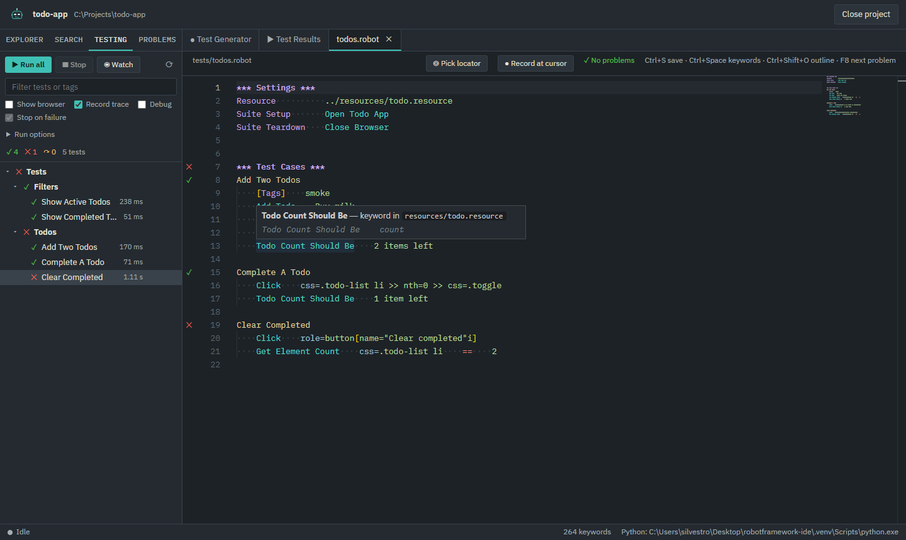
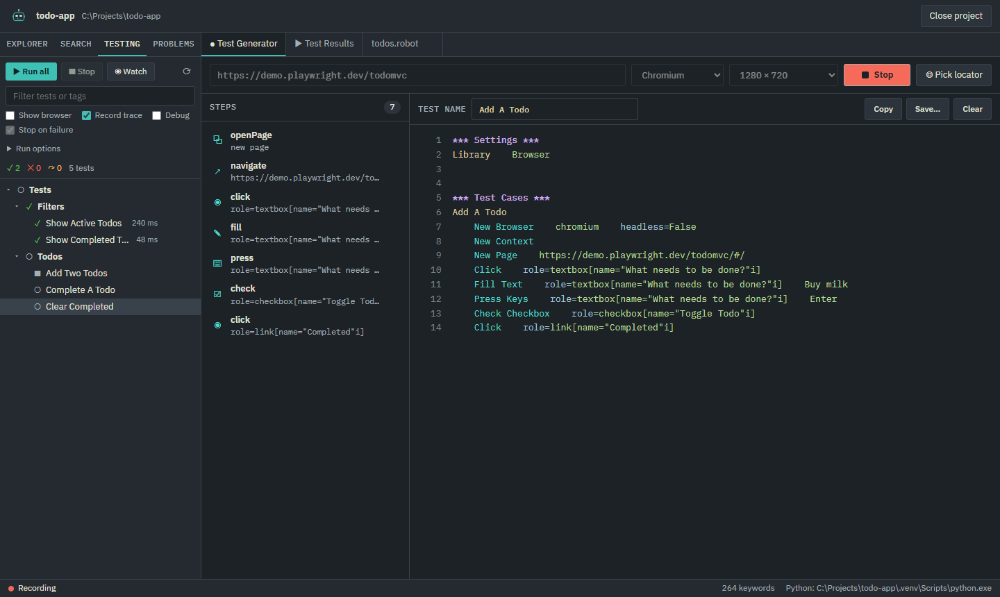
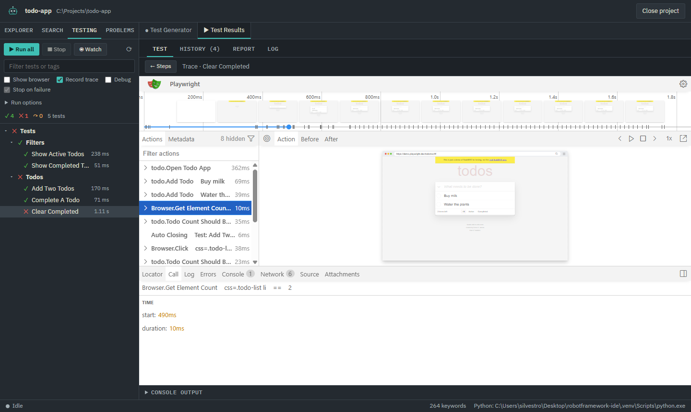
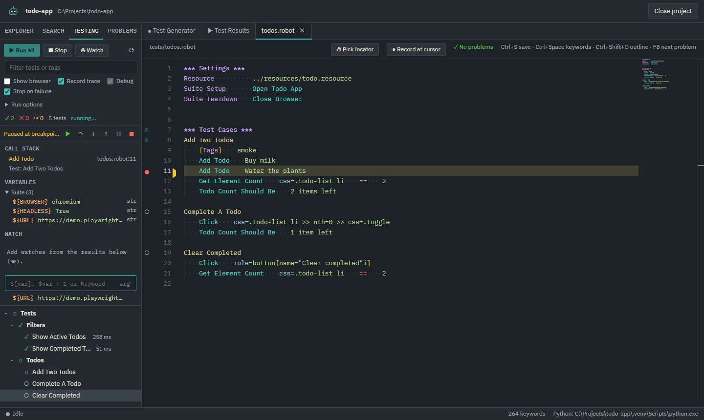

# User guide

This guide covers Keywright's Browser library workflow. To run the app from source,
see the [README](../README.md#run-from-source). For a failed setup or missing output, see
[Troubleshooting](troubleshooting.md).

Start with the [walkthrough](walkthrough.md) for a runnable local example that
connects recording, resource reuse, execution and failure diagnosis.

- [Projects](#projects)
- [Project configuration](#project-configuration)
- [Editor](#editor)
- [Test Generator](#test-generator)
- [Running tests](#running-tests)
- [Results and traces](#results-and-traces)
- [Debugging](#debugging)
- [MCP server](#mcp-server)
- [Keyboard shortcuts](#keyboard-shortcuts)
- [Updates and local settings](#updates-and-local-settings)
- [Current limitations](#current-limitations)

## Projects

### Create a project

Choose **New project** on the welcome screen, enter a name and select its parent
directory. Setup can create a Python environment, install Browser's dependencies
and initialize a Git repository. The preview shows the folder that will be created.
An existing folder with the same name is not overwritten.

The generated project contains:

```text
my-web-tests/
  keywright.json
  requirements.txt
  README.md
  .gitignore
  resources/
    common.resource
  tests/
    example.robot
  results/
  .venv/                 created when virtual environment setup is enabled
```

`common.resource` imports Browser and defines `Open Test Browser`, `${BROWSER}` and
`${HEADLESS}`. The example suite uses that keyword as suite setup and closes the
browser in suite teardown. `requirements.txt` lists Robot Framework, Browser and
Robocop; it currently does not pin their versions.

The setup view reports each step. A failure skips later steps and keeps the files
already created. You can open the partial project and finish setup in a terminal;
see [repair a partial setup](troubleshooting.md#project-setup-stopped-partway-through).

When setup finishes, choose **Open project**, then **Testing → Run all**. The
generated suite has one test that opens `https://example.com`; it needs network
access and should pass. Check that the footer names this project's Python.

With several Python versions installed, review the version shown in the setup
form. On Windows the creator tries `py -3.13` first, then `py -3`, `python` and `python3`.
For a specific Python version, prepare an environment as described below and open
its project folder.

Browser executables use the shared user cache rather than the project's `.venv`.
On Windows the default is `%LOCALAPPDATA%\ms-playwright`; the installer and test
runner use the same location. An explicit `PLAYWRIGHT_BROWSERS_PATH` is respected.
The project folder no longer needs to contain those browser executables.

### Open an existing project

Choose **Open folder…** and select the project root. Opening a folder does not run
`pip install`, initialize Browser, or rewrite your project structure.

By default, Keywright looks for:

- Python at `.venv\Scripts\python.exe`;
- suites under `tests/`;
- Robot output under `results/`.

If the project already runs in its own environment, keep using that environment.
For a project with `requirements.txt` that needs a new `.venv`, open PowerShell
in the **test project folder** and run:

```powershell
$env:PLAYWRIGHT_BROWSERS_PATH = "$env:LOCALAPPDATA\ms-playwright"
py -3.13 -m venv .venv
.\.venv\Scripts\python.exe -m pip install -r requirements.txt
.\.venv\Scripts\python.exe -m Browser.entry init chromium
```

This assumes the requirements include Robot Framework and Browser. The last
command installs Chromium; initialize Firefox or WebKit too if the tests use them.
For another dependency manager, use the project's own setup instructions and
select its Python in `keywright.json`. These commands use the environment's
executable directly, so activation is unnecessary. If you already use a custom
`PLAYWRIGHT_BROWSERS_PATH`, keep that value for installation and execution.

If your repository uses another layout or environment, create `keywright.json` at its
root. For example, a repository with suites at the root and a shared environment:

```json
{
  "testsDir": ".",
  "outputDir": "results",
  "python": "C:/Environments/web-tests/Scripts/python.exe"
}
```

The selected interpreter needs the libraries your tests import. System Python on
`PATH` is used to create environments, but is not automatically selected as the
interpreter of an opened project.

Close and reopen the project after preparing its environment or changing
`keywright.json`. In **Testing**, check that the expected suites appear, then run
one known test before running the full project. If discovery fails, see
[tests missing from Testing](troubleshooting.md#tests-are-missing-from-the-testing-panel).

Use **Explorer** to open files and create a file with **New file**. Paths such as
`tests/login.robot` create missing parent folders. Below the path, choose the type:
**Test suite** adds `.robot` and **Resource** adds `.resource` when the name has no
extension. The type starts as **Resource** inside the resources folder and as
**Test suite** elsewhere. A typed extension, such as `helpers.py`, is kept as it is
and selects **Other**. The line under the field shows the path that will be created.

Right-click a file or folder for **Open**, **New File…** (in that folder),
**Rename…**, **Delete**, **Copy Path**, **Copy Relative Path** and **Reveal in File
Manager**. Right-clicking below the files offers **New File…**, the project folder
and **Refresh Explorer**. Shift+F10 or the Menu key opens the same menu for the
focused row.

**Rename…** (F2) edits the name in place: Enter renames, Escape cancels, and
clicking elsewhere renames. Files open in tabs follow the new name, including
those inside a renamed folder. Unsaved changes in them are saved or discarded
first. Renaming the tests or resources folder does not update `keywright.json`;
change it in **Project settings**. **Delete** (Delete key) asks for confirmation
and moves the file or folder to the Recycle Bin, closing its tabs.

Drag the sidebar divider to resize it; double-click the divider to restore its
default width.

Editor file operations and disk replacements check where symbolic links and
Windows junctions lead. Destinations outside the opened project are refused.
Open a shared resource's own folder to edit it when it lives outside that project.
Robot can still import external resources during test execution.
If a file cannot be opened, its tab shows the reason. Correct the path or read
permissions, then close the tab and reopen the file to retry.

## Project configuration

**Project settings** in the title bar, or **Project: Open Project Settings** in the
command palette, edits the folders and the Python interpreter. Each field is checked
before saving: the tests folder must exist inside the project, the resources folder
must be inside it, and results need a folder of their own. Paths inside the project
are saved relative to it. **Save and reopen** writes `keywright.json`, keeping any
other properties in it, then reopens the project so every panel uses the new
settings. Open files close first, after the usual unsaved-changes prompt, and a
running test stops.

`keywright.json` is optional JSON stored at the project root. Omitted properties use
these defaults:

```json
{
  "version": 1,
  "testsDir": "tests",
  "resourcesDir": "resources",
  "outputDir": "results",
  "python": null
}
```

| Property | Meaning |
| --- | --- |
| `version` | Configuration version marker; currently not validated by the loader. |
| `testsDir` | Directory passed to Robot for discovery and execution, relative to the project root. Use `.` for root-level suites. |
| `resourcesDir` | Resource-folder convention used by the template and explorer's initial expansion. Robot resolves actual imports from the suite source. |
| `outputDir` | Results directory resolved against the project root. Used for reports, trace access, history and watcher exclusions. |
| `python` | Path to the interpreter. Relative paths resolve against the root; absolute paths are accepted. `null` selects the project's `.venv`. |

Use forward slashes in JSON paths, or escape backslashes as `\\`. The loader merges
the file with the defaults and currently validates JSON syntax rather than a full
configuration schema. Keep directory values as strings and use a dedicated output
directory. After editing the file by hand, close and reopen the project so its
watcher and interface state are recreated consistently.

## Editor

### Edit and save

Open a `.robot` or `.resource` file from **Explorer**. A dot on its tab indicates
unsaved edits. **Ctrl+S** saves the current file. Closing a modified tab or closing
the project offers to save, discard or cancel. Closing the application with modified
files offers to cancel or close without saving.

Files changed externally reload when their editor tabs have no unsaved edits.
Modified tabs keep their editor contents. Saving checks the disk revision read by
the editor. If it changed, choose **Keep Editing**, **Compare…**, **Overwrite File**,
or **Reload from Disk**. Reload discards the editor changes. A deleted file offers
**Recreate File** instead.

**Compare…** shows the file on disk on the left and your version on the right.
Edit the right side to combine both, then choose **Save Your Version**. **Use Disk
Version** discards your changes; **Keep Editing** or Escape returns to the editor
without saving. If the file changes again while you compare, saving raises a new
conflict and your combined text stays in the editor.
Edits made while a save is in progress remain marked as unsaved.

While you edit, Keywright keeps a copy of unsaved files in its user-data directory.
If it crashes or is closed without its usual prompt, reopening the project shows
which files had unsaved changes. **Restore** reopens them with those changes, still
unsaved, and **Discard** deletes the copy. A file that changed on disk in the
meantime raises the usual save conflict when you save it. Choosing **Close Without
Saving** deletes the copy.

If the window itself stops, Keywright saves a crash report and offers **Reload
Window**, **Show Crash Report** or **Quit**. After a reload the project opens again
with the same restore offer. Edits typed in the last second before the crash may
not be in the copy.

### Completion and navigation

**Ctrl+Space** opens keyword completion. Documentation and required argument
placeholders come from the libraries imported by the project and its user keywords.
Library documentation is collected using the project's Python.

| Action | How to use it |
| --- | --- |
| Keyword documentation | Hover over a keyword. |
| Go to definition | Ctrl+click or F12 on a keyword, variable or imported file path. |
| Find references | Shift+F12 on a keyword or variable. |
| File outline | Ctrl+Shift+O. |
| Rename | F2 on a project keyword or variable. |
| Quick fixes | Ctrl+. or the light bulb beside a diagnostic. |
| Next problem | F8. |

Rename follows supported Robot scopes and updates references across project files.
Open files receive undoable edits; other affected files are saved to disk. Library
keywords, embedded-argument keyword definitions and variable-file definitions are
not renamed. Review a project-wide rename before running or committing the suite.

Quick fixes include similar keyword/variable names, creating a missing keyword,
defining a variable, adding a missing `END`, and adding a Robocop suppression.



### Diagnostics and formatting

The editor checks unsaved content while you type. **Problems** collects findings
across the project's Robot files.

| Check | Scope and limits |
| --- | --- |
| Robot syntax | Uses Robot's parser through the project's Python. |
| Unknown keywords | Reported when imported library documentation is complete. Import failures make this check conservative. |
| Keyword arguments | Checks supported calls for missing, extra or misplaced arguments. Dynamic expansions, embedded arguments and ambiguous calls are excluded. |
| Undefined variables | Uses local definitions, imports and known project runtime assignments. Values supplied only through `--variable` can still be reported. |
| Robocop | Optional lint diagnostics from the project environment. The Problems switch can hide its findings. |

**Shift+Alt+F** formats the current document with Robocop, including unsaved edits.
Formatting applies the project's supported configuration in `robocop.toml`,
`pyproject.toml` or `robot.toml` and leaves the result in the editor to be saved.
If Robocop is missing, Keywright offers to install it in the project environment.

Library documentation is cached while the project is open. Saved Python files inside
the project refresh it automatically. After installing packages or changing a
library outside the project folder, choose **Reload libraries** in the status bar;
see [completion troubleshooting](troubleshooting.md#completion-or-diagnostics-are-missing-or-stale).

### Search and replace

**Ctrl+Shift+F** opens project search. Options include case sensitivity, whole words,
regular expressions and include patterns such as `*.robot, tests/`.

Search includes unsaved contents of open editor files and disk contents of other
files. Tool directories, the configured output directory, binary files and files
over 2 MiB are excluded from disk search. Disk results are limited to 5,000 matches.

Replacement previews appear beside matches. Replace one match, one file or all
listed results; **Replace all** asks for a second click. Open files receive unsaved,
undoable edits. Other files are written to disk. Regex replacements accept capture
groups such as `$1`.

### Command palette

**Ctrl+P** opens a project file by name. Type any letters of its path in order:
`acres` finds `resources/access.resource`. Open files are listed first.

**Ctrl+Shift+P**, or `>` at the start of the Ctrl+P box, lists commands: saving,
editor navigation, panels, test runs, debugger steps, recording and project
actions. Only commands that apply at that moment are listed; the debugger steps,
for example, appear during a debug run. Up and Down select, Enter runs, Escape
closes.

## Test Generator

### Record a standalone test

1. Open **Test Generator** and enter the starting URL.
2. Select a browser and viewport. Chromium, Firefox and WebKit use Playwright
   binaries; Chrome and Edge use their installed browser channels.
3. Press **Record** and interact with the opened page.
4. Use the toolbar in that page to add assertions for visible elements, text,
   values, checkbox state or an ARIA snapshot.
5. Stop recording. Review the steps and remove unwanted actions.
6. Set **Test name**, then **Copy** or **Save…** the generated source.

The standalone output imports Browser and creates a browser and context before
the recorded steps. It can be run with the project's Python. For example:

```robotframework
*** Settings ***
Library    Browser
Test Teardown    Close Browser    ALL

*** Test Cases ***
Example Domain Has Expected Title
    New Browser    chromium    headless=True
    New Context
    New Page    https://example.com
    Get Title    ==    Example Domain
```

This example includes an explicit teardown. Adapt recorded source to the setup,
teardown, variables and reusable keywords used by your suite.

| Recorded action | Browser keywords used |
| --- | --- |
| Open or navigate | `New Page`, `Go To` |
| Click or modified click | `Click`, `Click With Options` |
| Type, press keys, select or check | `Fill Text`, `Press Keys`, `Select Options By`, `Check Checkbox` |
| Assert text, value, checked state, visibility or snapshot | `Get Text`, `Get Property`, `Get Checkbox State`, `Wait For Elements State`, `Get Aria Snapshot` |
| Popup, dialog or download | `Switch Page`, `Handle Future Dialogs`, `Promise To Wait For Download` |

File-upload recordings require review: generated comments ask you to replace
recorded filenames with usable file paths. Unsupported recorded actions are emitted
as comments rather than silently converted into another operation.



### Pick a locator or record into a file

**Pick locator** lets you click an element and obtain its Browser selector, for
example `role=button[name="Sign in"i]`. During recording it uses the recorded browser;
otherwise it opens a picker browser at the selected URL. In an editor tab it inserts
the selector at the cursor.

**Record at cursor** inserts the recording's keyword calls into an open Robot file,
indented like the surrounding source. The file is read-only while this recording
is active. One undo removes the recorded block after recording stops.

This mode inserts steps, including `New Page`, but does not add a Browser import or
create a browser and context. Provide those in your test or its setup.

### Browser installations

There are two toolchains, each with its own Playwright version:

- **Test Generator:** uses Keywright's pinned `playwright-core`. When a launch fails
  because a downloadable browser is missing, the generator offers an installation
  action using the app's runtime.
- **Project tests:** use Browser installed in the selected Python environment.
  Keywright's project creator prepares it with `rfbrowser init` and requires Node.js
  for that setup route.

Both use the shared browser cache by default. Different Playwright versions may
need different revisions in that cache; initialize Browser using the project's
Python when its required revision is missing.

A recorder that launches successfully does not prove the test environment is ready.

## Running tests

Open **Testing** to discover suites under `testsDir`. Run the project, a suite or an
individual test with its run button. Text search narrows the displayed tree and
changes **Run all** to **Run visible**, which runs that displayed selection.
**Stop** terminates Robot and its child processes,
including the browsers started by Browser library.

Tests execute **saved files on disk**. Every run action checks all modified editor
files, including resources and Python libraries. Choose **Save All and Run** to
save them before discovery and execution, **Run Saved Files** to use disk contents
while keeping editor changes unsaved, or **Cancel**. Testing displays a notice
when unsaved changes are excluded. A failed or cancelled save prevents the run.

### Run options

| Option | Effect |
| --- | --- |
| Show browser | Adds `--variable HEADLESS:False`. Your test must use `${HEADLESS}` for this to affect `New Browser`. |
| Record trace | Enables Browser tracing for explicit `New Context` calls. Enabled by default in the UI. |
| Debug | Enables breakpoints and debugger controls. |
| Stop on failure | While debugging, pauses at unexpected keyword failures before teardown. |
| Include tags / Exclude tags | Robot patterns, comma-separated; examples: `smoke`, `fastANDui`, `reg*`, `NOTslow`. |
| Browser | Sets `${BROWSER}` to Chromium, Firefox or WebKit. Your setup must use that variable. |
| Dry run | Asks Robot to validate the suite without executing its test keywords. |
| Arguments | Additional Robot options, such as `--loglevel DEBUG` or `--variable ENV:staging`. |

Tag filters apply to project and suite runs. An explicitly selected individual test
or set of individual tests bypasses the include/exclude tag filters; this also
applies to **Run visible**, which passes an explicit list of tests. The template's
setup uses `${BROWSER}` and `${HEADLESS}`; recorded source with literal values must
be adapted if you want those controls to affect it.

Arguments are passed to Robot, not to a shell. Quote a value containing spaces;
shell pipelines, redirections and environment expansion are not supported here.
Run options are stored per project. Avoid overriding output paths with extra Robot
arguments if you want Keywright to locate the resulting reports and traces.

### Watch mode

Enable **Watch** for the project or the watch control beside a suite or test. Saved
changes can trigger a new run:

- a changed suite file re-runs its watched tests;
- a changed dependency or other relevant file re-runs all watched tests;
- changes during a run are queued for processing afterwards.

Relevant extensions are `.robot`, `.resource`, `.py`, `.yaml`, `.yml`, `.json`, `.txt`
and `.csv`. Tool folders and output files are ignored. Dependency handling is
conservative; it does not calculate an exact per-test import graph.

Watch pauses when open files have unsaved changes and displays a notice in Testing.
Save the changes to resume on the next relevant file event. Watch never opens the
save dialog automatically; run manually to choose **Run Saved Files**.

## Results and traces

### Read a failed run

Select a test in **Testing** and open **Test Results**. The **Test** view shows its
status, message, executed keyword tree, timings and log messages. Suite setup and
teardown steps appear around the test's own steps. A setup failure can prevent the
test body from running.

Use **Go to source** to return to the test, or **Open log** to inspect Robot's log.
Browser screenshots appear when the library emits screenshot references and the
files are available. Expand **Console output** for Python imports, Robot command
output and errors that occur before test events are received.

**Report** and **Log** embed `report.html` and `log.html` from the configured output
directory. They describe the latest run that wrote those files. They can also be
opened externally using **Open in browser**.

### Inspect a trace

With **Record trace** enabled, Browser records explicit contexts created by `New
Context`. **Trace** opens the available archive in the embedded Playwright viewer
with snapshots, network activity, console and Robot keyword groups.

- The archive is written when its browser context closes. It may not exist while
  the test is paused or the context is still open.
- A context created in suite setup can produce a shared trace for the suite.
- Contexts implicitly created by `New Page` are not covered by this integration.
- Force-stopping a run can leave a trace unfinished.
- A later run may replace Browser artifacts. Copy evidence you need to retain.



### Compare run summaries

**History** keeps the last 30 run summaries in `<outputDir>/.keywright-history.json`.
It compares test statuses and timings against the preceding stored run: new
failures, fixed tests, continuing failures, slower tests and newly seen tests.
Runs without completed test results are not stored.

History stores summaries and shortened failure messages. It does not archive each
run's source, screenshots, reports or traces. Comparisons also depend on which tests
ran; a filtered run is not equivalent to a full-project run.

## Debugging

1. Open the source and set a breakpoint by clicking the gutter or pressing **F9**.
2. Save the source and any changed resources.
3. Enable **Debug** in Testing and run the test.
4. When execution pauses, inspect the highlighted line, call stack and variables
   by local, test, suite and global scope.
5. Continue or step using the controls below.

Right-click a breakpoint to add a condition, written as a Robot `IF` expression,
such as `$i == 5` or `len($items) > 3`. An invalid condition pauses with its error
rather than being treated as false.

**Stop on failure** pauses before teardown where a keyword unexpectedly fails.
Failures handled through supported expected-failure constructs, such as TRY or
`Run Keyword And Ignore Error`, are skipped by that pause behavior.

The evaluation input accepts:

| Input | Example |
| --- | --- |
| Variable | `${user}[name]` |
| Python expression using Robot variables | `$count + 1` |
| Keyword call, with Robot cell separators | `Get Text    h1` |

Evaluating a keyword executes it in the paused test and can change the application
under test. Pin a result to add a watch evaluated at subsequent pauses. Pinned
watches evaluate variables or expressions; they do not repeatedly execute keywords.

Breakpoints are stored per project and can be changed during a run. Execution
continues against the saved source; editing a file does not replace the source of
an already-running Robot process.



## MCP server

Keywright can act as an MCP server, so that an AI client such as Claude Code,
Codex, Antigravity, Claude Desktop or Cursor works on the open project. The client can read and
change project files, look up keywords, check and run tests, and drive its own
browser to explore the application under test and write tests from what it finds.

### Connect a client

1. Click **MCP** at the right of the title bar, or run **Open MCP Server**
   from the command palette.
2. Turn on **Allow AI clients to connect**. The setting is kept for the next start.
3. Choose the client in the list, copy its configuration and add it where the
   dialog says. Claude Code takes a terminal command; Codex takes a table in
   `~/.codex/config.toml` (or `codex mcp add`); Antigravity, Claude Desktop and
   Cursor take an entry under `mcpServers` in their JSON file. For Antigravity that
   file is `~/.gemini/config/mcp_config.json`.
4. Click **Test connection**. Keywright reads the Keywright entry from the client's
   own file, starts it exactly as the client will, performs the same MCP handshake
   and reports the tools it received, or the reason it failed. A check mark means
   that client's entry works. For a client without an entry, the test only says
   that the configuration shown works on this computer and where to add it. For
   **Other client (HTTP)** it checks the address and token.

Keywright does not write to the clients' files. Each time the dialog opens, or the
window regains focus, it reads them and shows under each client's name whether the
Keywright entry is configured, missing, needs updating or cannot be read. *Needs
updating* means the entry starts another Keywright folder or Electron, points to
another connection file, or lacks `ELECTRON_RUN_AS_NODE=1`; for example after moving
the Keywright folder. When a client actually connects, its name shows the time.
Antigravity entries in the older `~/.gemini/antigravity/mcp_config.json` are
recognized too.

The configuration starts a small bridge script with Keywright's own Electron runtime.
The bridge finds the running Keywright through a connection file in the user-data
directory, so the configuration contains no token and keeps working when the port
changes. Keywright must be running with the connection on; otherwise the client
receives a message saying so.

**Other client (HTTP)** shows the server address and bearer token for clients that
connect to a Streamable HTTP URL. Keywright listens on `127.0.0.1`, port 47811 by
default, or a free port when that one is taken. **New token** replaces the token;
clients configured over HTTP then need the new one.

The dialog shows the connected clients, the last tool called and whether the AI's
browser is open. Turning the connection off stops the server and closes that browser.

### What the client can do

| Area | Tools |
| --- | --- |
| Project | `project_info`, `list_files`, `read_file`, `search_project` |
| Changes | `write_file`, `edit_file`, `rename_path`, `delete_path` |
| Robot | `find_keywords`, `check_file`, `discover_tests`, `run_tests`, `wait_for_run`, `test_failure_details`, `stop_tests` |
| Browser | `browser_open`, `browser_navigate`, `browser_back`, `browser_forward`, `browser_reload`, `browser_snapshot`, `browser_click`, `browser_fill`, `browser_press`, `browser_select`, `browser_check`, `browser_hover`, `browser_assert`, `browser_wait_for`, `browser_screenshot`, `browser_tabs`, `browser_steps`, `browser_close` |

The client works on the project that is open in Keywright. Changes appear in the
explorer and in open tabs without unsaved changes, as edits from another program
would. A file with unsaved changes in the editor, or a folder containing one, is not
changed, renamed or deleted; the client is told to ask you to save or discard first.
`delete_path` moves entries to the Recycle Bin. There is no confirmation dialog for
the client's changes.

**File changes by AI clients**, at the bottom of the MCP server dialog, lists what
the client created, edited, renamed or deleted since Keywright started, newest first.
Click a path to open the file. **Undo** puts the file back as it was before the
change, but only while the file is still as the client left it: if you or the client
changed it since, undo the later change first. Undoing a created file moves it to the
Recycle Bin. Keywright keeps a copy of deleted entries up to 20 MB to restore them;
larger ones stay in the Recycle Bin. The list holds the last 100 changes and is
cleared when Keywright closes. The title bar button's tooltip counts the changes not
undone.

`run_tests` uses the files on disk, like the Testing panel. The run appears in the
Testing panel, and the client receives each test's status, the failing keyword and
message, and the end of the console output.

AI clients stop waiting for a tool after a time limit: 60 seconds by default in
Codex and 180 seconds in Antigravity. `run_tests` therefore returns within about
45 seconds. If tests are still running, it returns the results so far, and the
client calls `wait_for_run` to wait for the rest in further steps. A run of any
length works without changing the client's timeout.

When a test fails, `test_failure_details` gives the client the failing keyword with
its file and line, the surrounding source lines, the test's log messages, and the
last screenshots Browser took, as images. The client can then see what the page
showed at the failure instead of guessing from the message.

### How the AI writes a test from the browser

The AI's browser is a separate, visible Chromium window, independent of the Test
Generator. The client reads each page as an accessibility snapshot in which elements
carry references such as `[ref=e5]`, and acts on those references.

Before each action, Keywright turns the reference into the locator Playwright's
code generator would choose, acts through that locator, and records the action in the
Test Generator's format. Every result includes the Browser step for the action, for
example `Click    role=button[name="Sign in"i]`, and a new snapshot. Dialogs are
dismissed and recorded as `Handle Future Dialogs`; frames become `>>>` selectors;
new pages become `Switch Page`.

`browser_assert` checks text, visibility, a field's value or a checkbox state on the
page, waiting up to five seconds, and adds the matching `Get Text`, `Wait For Elements
State`, `Get Property` or `Get Checkbox State` step only when the check passes.
`browser_steps` returns the recorded steps, or a complete test with `complete: true`.
The client then writes the file, preferably with the project's own keywords, and runs
it. Review generated selectors and assertions as you would a recording.

## Keyboard shortcuts

| Shortcut | Action |
| --- | --- |
| Ctrl+S | Save current file |
| Ctrl+P | Open a file by name |
| Ctrl+Shift+P | Command palette |
| Up / Down, Home / End in Explorer or Testing | Move focus through visible tree items |
| Left / Right in Explorer or Testing | Collapse/expand a folder or move to its parent/child |
| Enter / Space in Explorer or Testing | Activate the focused row |
| F2 in Explorer | Rename the focused file or folder |
| Delete in Explorer | Move the focused file or folder to the Recycle Bin, after confirmation |
| Shift+F10 / Menu key in Explorer | Open the context menu of the focused row |
| Left / Right, Home / End on a tab | Switch between tabs in that tab group |
| Delete on a file tab | Close that tab, resolving unsaved changes first |
| Ctrl+Space | Keyword completion |
| Ctrl+click / F12 | Go to definition |
| Shift+F12 | Find references |
| Ctrl+Shift+O | File outline |
| F2 | Rename supported keyword or variable |
| Ctrl+. | Quick fixes |
| Shift+Alt+F | Format document with Robocop |
| F8 | Next editor problem |
| Ctrl+Shift+F | Project search |
| F9 | Toggle breakpoint |
| F5 | Continue a paused debug run |
| F10 | Step over |
| F11 | Step into |
| Shift+F11 | Step out |

Debugger shortcuts apply while debugging. Editor actions depend on the focused
editor and the item under the cursor.

## Updates and local settings

On the welcome screen, expand **Update Keywright** for source update instructions.
For a Git clone, close Keywright and run these commands in its source folder:

```powershell
git pull --ff-only
.\setup.bat
```

Git stops if it cannot update by fast-forward; review local changes before
continuing. For a ZIP download, extract the latest archive into a new folder and
run `setup.bat` there. Keep Robot test projects in their existing folders.
The app does not download updates or change its source files.

Recent projects, sidebar width, breakpoints, watches, run options, copies of
unsaved files, the MCP server's setting and token, and copies of entries an AI
client deleted are stored in Electron's
user-data directory, separately from your test source. Some settings are per project; pinned
watches and sidebar width are shared application settings.

## Current limitations

- Browser library is the supported browser integration; SeleniumLibrary is not.
- Python dependencies are installed separately for each selected project environment.
- Test execution uses saved disk contents, with the save behavior described above.
- Save conflicts can be compared side by side, but there is no automatic three-way merge.
- Package installations and library changes outside the project folder are not detected automatically. Use **Reload libraries** in the status bar.
- History retains summaries rather than complete run artifacts.
- Traces depend on explicit Browser contexts and their successful closure.
- The Test Generator depends on private Playwright recorder APIs; upgrades require
  replay verification.
- The MCP server works on the open project only and cannot open or create
  projects. Its browser has no tools for file uploads or going back, and a click
  that starts a download is recorded without waiting for the download.

For recovery steps, see [Troubleshooting](troubleshooting.md). For a reproducible
defect, open an [issue](https://github.com/silvestrodecaro/keywright/issues) with the
versions, a minimal example and sensitive data removed.
